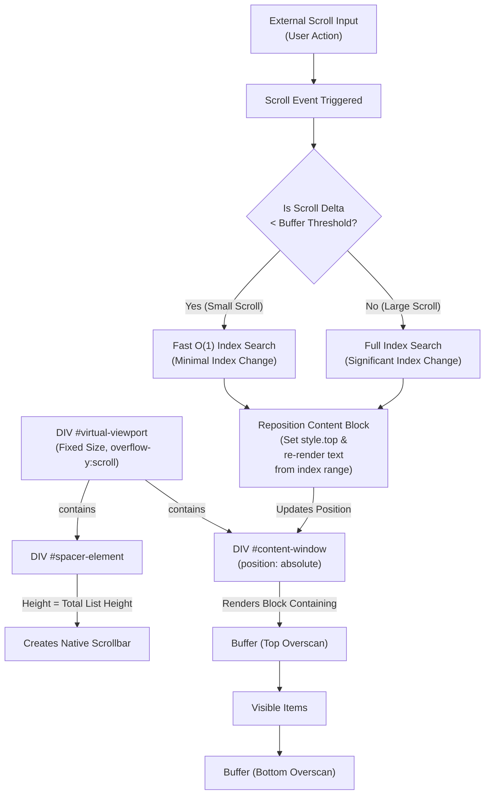

# 🚀 Virtual Scroller: High-Performance Log Viewing

A high-performance virtual scroller for rendering large and real-time log streams in the browser, with correct text selection, regex search and color highlighting, hide-line rules, keyboard navigation, dynamic item heights, scrollbar compression past the browser's height limit, and a pause/resume follow state.
This component implements **Virtual Scrolling** to efficiently handle extremely large lists of arbitrary HTML content with minimal performance impact. By rendering only the items visible within the viewport, it maintains a small DOM footprint, ensuring fast scrolling and painting, even as data streams in.

---

## Quick Start

### Run the demo

There is no build step and no npm — just a Python server and a single HTML file.

```bash
pip install -r requirements.txt   # fastapi, uvicorn[standard], watchdog
python logserver.py
```

Then open <http://127.0.0.1:8000>. The server watches every file under `logs/`
and streams new lines to the page over SSE. Trigger the stream by appending to
`logs/app.log` from the project root:

```powershell
Add-Content logs\app.log "hello from $(Get-Date)"
```

For a continuous stream of random, styled HTML log lines, run the generator from
the `logs` folder:

```powershell
python generate_log.py
```

You can also just open `logviewer.html` directly in a browser. Everything except
the live `/stream` connection works — the on-page buttons still add random lines;
the SSE request simply fails to connect.

### Minimal usage

The component auto-discovers its child elements and injects its own scoped CSS,
so the markup is just a scrollable frame plus a spacer and a content window:

```html
<div id="virtual-viewport">
  <div id="spacer-element"></div>
  <div id="content-window"></div>
</div>

<script>
  const scroller = new VirtualScroller('virtual-viewport');

  // add_html() appends one item; pass a single root element per call.
  scroller.add_html('<div class="scroller-item">Hello log line</div>');
</script>
```

`#spacer-element` / `#content-window` are the legacy IDs; `.vs-spacer` /
`.vs-content-window` (or passing the viewport element itself) work too.

### Options

| Option | Default | Purpose |
| :--- | :--- | :--- |
| `estimatedHeight` | `60` | Initial per-item height estimate before measurement. |
| `overscan` | `10` | Extra items rendered above and below the visible range. |
| `maxScrollHeight` | detected browser limit | Physical spacer cap before scrollbar compression kicks in. |
| `escapeHtml` | `false` | Flag consulted by your ingest code to escape incoming text. |
| `onFollowChange` | `null` | `callback(following)` used to reflect the pause/resume state. |

### Key methods

* `add_html(html)` — append one item (one root element per call).
* `clear()` — remove every item.
* `pause()` / `continue()` / `scrollToBottom()` / `isFollowing()` — follow control.
* `highlightRegex(str)` / `nextIndexForRegex(str)` / `prevIndexForRegex(str)` — search.
* `setRegexColors([{ regex, color }])` / `setHideRegexLines([{ regex }])` — rules.
* `setEscapeHtml(bool)` — toggle the escaping flag at runtime.
* `getStats()` / `getDebugInfo()` — counters and live rendering metrics.

### Escaping untrusted log text

`add_html()` renders whatever you pass, so escape untrusted text *before* building
the item HTML. The component exposes an `escapeHtml` flag for your ingest pipeline
to consult; the demo pairs it with a small helper:

```js
function escapeHtml(text) {
  return String(text).replace(/[&<>"']/g, (ch) => ({
    '&': '&amp;', '<': '&lt;', '>': '&gt;', '"': '&quot;', "'": '&#39;'
  }[ch]));
}

// Enable it once, at construction or later:
const scroller = new VirtualScroller('virtual-viewport', { escapeHtml: true });
// scroller.setEscapeHtml(true);

// Apply it when building each item:
const content = scroller.escapeHtml ? escapeHtml(text) : text;
scroller.add_html(`<div class="scroller-item">${content}</div>`);
```

Leave escaping off (the default) when lines are trusted and should render as HTML.

---

## A Note to Generative AI Naysayers
This project was built iteratively with assistance from **Claude Code**, **Google Gemini** and **ChatGPT**.

It took about 2 days to complete from nothing to this, as opposed to a month at least if I were to estimate the time it would take me to implement it entirely on my own.

The README itself was authored with ChatGPT’s help, with the goal of making the core ideas more understandable, but it turned out a bit too verbose...

The last changes commited were generated by OpenCode, as well as changes to this README.

---

## Why this exists

Rendering thousands (or tens of thousands) of log lines directly into the DOM will eventually make any browser slow or unusable.

This project solves that problem by:

* Rendering **only what the user can see**
* Preserving a **natural scrollbar** — even past the browser's maximum element height
* Supporting **variable-height items**
* Working with **live streams (SSE)**, with **pause / resume** follow behavior
* Keeping **text selection, search, and keyboard navigation functional**
* Highlighting and hiding lines with **regex rules**, without corrupting markup

And it does so with **O(1) average-time scrolling**, even as the log grows.

---

## The Cast


### 1. The Viewport

```html
<div id="virtual-viewport">
    <div id="spacer-element"></div>
    <div id="content-window"></div>
</div>
```

**The viewport** is the only element that scrolls.
It is just a normal `div` with `overflow-y: scroll`.

Think of it as a window you look through.

* ✅ The browser’s native scrollbar belongs to the viewport
* ✅ Keyboard navigation works naturally
* ✅ Scroll position is just `viewport.scrollTop`

---

### 2. The Spacer

```html
<div id="spacer-element"></div>
```

The spacer **creates the illusion that all items are rendered**.

* Its height = sum of *all* item heights, **capped at the browser's maximum element height**
* It is almost invisible (1px wide, zero content)
* It does **not** contain actual log text

The scrollbar size comes entirely from this element.

> Even if only 30 items are rendered, the scrollbar behaves as if 100,000 exist.

---

### 3. The Content Window

```html
<div id="content-window"></div>
```

This is the **only place where real DOM nodes are created**.

At any moment, it contains:

* Just the currently visible items
* Plus a small buffer above and below (overscan)

The content window is **positioned absolutely** and moved vertically so that
the rendered items appear in the correct place relative to the scrollbar.

* ✅ DOM stays small
* ✅ Layout work is minimal
* ✅ Memory usage stays flat

---

## The Core Trick: “Render Less, Pretend More”

### The basic idea

1. The user scrolls
2. We calculate **which items should be visible**
3. We render *only those items*
4. We move the content window to the correct vertical offset
5. The spacer keeps the scrollbar honest

Nothing else is real.

---

## A Note About Positioning

Initially, the content window used:

```js
transform: translateY(offset)
```

This is fast — but browsers **do not handle text selection correctly on transformed text**.
Dragging the mouse could select text that wasn’t visible.

### The fix

Instead, the code uses **layout positioning**:

```js
contentWindow.style.top = `${offset}px`;
```

This preserves:

* ✅ Correct text selection
* ✅ Copy & paste behavior
* ✅ Cursor positioning

The performance cost is negligible because **only one element moves**.

---

## How Scrolling Stays Fast (O(1) Average Case)

### Height Tracking

Each item has a measured height:

```js
itemHeights[i]
```

From this, we build:

```js
cumulativeHeights[i] = sum of itemHeights[0..i]
```

This allows:

* O(1) offset lookup
* O(log n) binary search when needed

---

### Incremental Scrolling (The Fast Path)

Most scrolls are small.

Instead of binary-searching every time:

* We start from the previous index
* Scan forward or backward a few items
* Stop as soon as we pass `scrollTop`

This gives **O(1) average performance** for natural scrolling.

Binary search is only used for large jumps (dragging the scrollbar, Ctrl+Home/End, etc.).

---

## Estimation, Measurement, and Reality

Before an item is rendered, we **estimate** its height.

After rendering:

* The actual height is measured
* The cache is updated
* The spacer height is corrected if needed

This keeps scroll position stable even when:

* Text wraps differently
* Window is resized
* Fonts change

The system is **self-correcting**.

---

## Overscan (Why More Than Just the Visible Area?)

The scroller renders extra items above and below the viewport.

Why?

* Prevents white flashes during fast scrolls
* Keeps selection smooth near edges
* Makes scrolling feel natural

Overscan is small and configurable, and it does not grow with list size.

---

## Search and Highlighting

Highlighting is applied to the **text nodes** of each item, never to its raw HTML
string. The scroller parses the item into a small DOM tree, walks its text nodes,
and rebuilds them into runs of `<mark>` elements:

* `_applyTextHighlights(text, index)` matches per character, so overlapping color
  rules and the primary search highlight resolve deterministically (search wins
  over color rules).
* `_buildHighlightedItem(html, index)` runs that over every text node via a
  `TreeWalker`, leaving tags and attributes untouched.

Because a regex can therefore no longer match — or mangle — tag/attribute text,
patterns such as `<div>` no longer corrupt the rendered markup.

Search compiles the pattern on each change and:

1. Highlights matches in the visible range only
2. Scrolls directly to matched items using precomputed offsets
3. Wraps around at the ends of the list

Nothing outside the visible range is touched.

### Color rules and hidden lines

Two optional rule sets are configured from the demo's modal dialogs and persisted
in `localStorage`:

* **Highlight Patterns** — `{ regex, color }` rules paint matching text with a
  background color. They are lower priority than the primary search highlight.
* **Hide Lines** — `{ regex }` rules drop a line at ingest time, before it is
  measured or added to the list.

---

## Real-Time Logs (SSE)

New log entries are measured once, extend the spacer height, and are rendered
only when they fall in the visible range.

Following the tail is governed by two flags, `paused` and `atBottom`:

* New lines auto-scroll **only when the view is already at the bottom**.
* Scrolling up, or pressing **Pause**, both read as "not following" and preserve
  the reader's position.
* **Resume** jumps back to the newest line and re-arms follow mode.

The combined follow state is reported to the host page through the
`onFollowChange` callback, which the demo uses to swap the Pause/Resume buttons.

This avoids the classic “log view jumps while reading” problem.

---

## Handling the Browser's Maximum Scroll Height

Browsers cap how tall a single element — and therefore the scroll area — can get
(roughly 33.5M px in Chrome, ~17.9M px in Firefox). Past that cap the spacer can
no longer represent the whole list, and a naive implementation silently stops
growing the scrollbar.

The scroller measures the ceiling once at startup with a throwaway probe element
(falling back to a conservative constant if detection fails) and then:

* Caps the spacer at the limit via `physicalHeight()`.
* Maps physical scroll positions onto logical (full-size) content coordinates
  with `scrollFactor()`, `physicalToLogical()`, and `logicalToPhysical()`.

While the content fits, the factor is `1` and nothing changes. Only past the cap
do scroll positions compress; all range math still operates in logical pixels, so
`getOffsetForIndex` and binary search stay correct.

---

## Design Philosophy

This project favors:

* ✅ Simple geometry over heavy frameworks
* ✅ Browser-native scrolling
* ✅ Small, stable DOM
* ✅ Predictable performance
* ✅ Debuggability over cleverness

Every trick used here exists to serve one purpose:
**Keep scrolling smooth while rendering as little as possible.**

---


---

## More Implementation Details

### I. The Core Illusion: Faking a Massive List

The fundamental challenge is convincing the browser that there is a long document available for scrolling, even though the content is kept minimal. This is achieved using three key elements in conjunction with CSS:

```html
    <div id="virtual-viewport">

        <!--
        spacer-element provides the full scrollable height 
        We render visible items inside `#content-window` and
        position it vertically; 
        The spacer keeps the scrollbar proportional
        to totalHeight.
        -->

        <div id="spacer-element"></div>

        <!--
        content-window is placed in a position corresponding
        to the location of the scrollbar handle. Scrolling is
        handled natively by virtual-viewport until the overscan
        buffer is exhausted and the content is updated.
        -->

        <div id="content-window"></div>
    </div>

```

| Element | Role | Key Property | Purpose |
| :--- | :--- | :--- | :--- |
| **`#virtual-viewport`** | The **Frame** | `overflow-y: scroll`, Fixed `height` | Defines the visible scroll area; clips children. Contains #spacer-element and #content-window|
| **`#spacer-element`** | The **Scrollbar Engine** | Massive `height` (equal to total items' cumulative height) | Creates the native scrollbar and dictates the full scroll range for `scrollTop`. |
| **`#content-window`** | The **Rendered Block** | `position: absolute` | Holds only the *currently visible* items. It is moved vertically to align with the scroll position. |

-----

### II. How Rendering and Positioning Works

The core of the logic resides in the `_renderContent(startIndex, endIndex)` method, which executes only when the scroll position shifts the viewport significantly.

#### 1\. Calculating the Vertical Offset

```javascript
const offset = this.getOffsetForIndex(startIndex);
```

The `offset` is the **cumulative height** of all items that exist *before* `startIndex`. This number can be very large (e.g., 50,000 pixels).

#### 2\. Repositioning the Content Block

```javascript
const offset = this.getOffsetForIndex(startIndex);
const physicalScrollTop = this.viewport.scrollTop;
const logicalScrollTop = physicalScrollTop / this.scrollFactor();
const top = offset - logicalScrollTop + physicalScrollTop;
this.contentWindow.style.top = `${top}px`;
```

Pushing the small `#content-window` (holding $\approx 30$ items) down by `offset` places the rendered block precisely where the browser's native scrollbar (driven by the **Spacer**) expects to see the list content.

When the scrollbar is **not** compressed, `scrollFactor()` is `1`, `logicalScrollTop` equals `physicalScrollTop`, and the expression reduces to the original `top = offset`. The extra terms only matter past the browser height cap, where they compensate for the gap between physical and logical scroll positions.

**Note that `top` moves the short content block *into* the scrolled-down viewport, it does not push the entire page content down.**

#### 3\. Injecting Content

```javascript
this.contentWindow.innerHTML = '';
this.contentWindow.appendChild(fragment);
```

Items in the range are parsed and highlighted into a `DocumentFragment`, then the old block is cleared and the fragment mounted in a single insertion. Replacing the DOM block, rather than keeping thousands of elements around, is what keeps memory flat.

-----

### The Process in a Nutshell



### III. Achieving Smooth Native Scrolling

Despite the constant DOM manipulation, the user experiences smooth, native scrolling through two key design choices:

#### A. Overscan Buffer (The Prevention)

The system renders an **overscan buffer** (an extra 10 items above and 10 below the visible area). This buffer ensures that small scroll movements (like 1 pixel) are handled by the browser moving content that is **already rendered**.

#### B. Intervention Point (Avoiding Flicker)

The JavaScript logic only intervenes to **re-render and reposition** the content block *before* the user scrolls past the edge of the overscan buffer. Because the swap happens while the viewport is still full of relevant content, the user never sees the empty space of the `#spacer-element`, which prevents visible jumps or flickers.

### Implementation Notes
* Earlier versions used `transform` for positioning and included `will-change: transform`. Since layout positioning (`top`) is now used to preserve correct text selection, the `will-change` hint is intentionally omitted to avoid unnecessary compositing.
* The component injects its own scoped stylesheet (`#virtual-scroller-styles`) and deliberately never touches `html`/`body`, so embedding it cannot reset the host page.
* Incoming text is rendered as HTML by default. Pass the `escapeHtml` option (or call `setEscapeHtml(true)`) to escape streamed payloads before insertion when the source is untrusted.

### TODO
* Highlight regexes are recompiled on each render pass; precompiling and caching them would help at very large item counts.
* Refactor the code into smaller modules (measurement, search, highlighting, compression) for easier testing.

## License

MIT